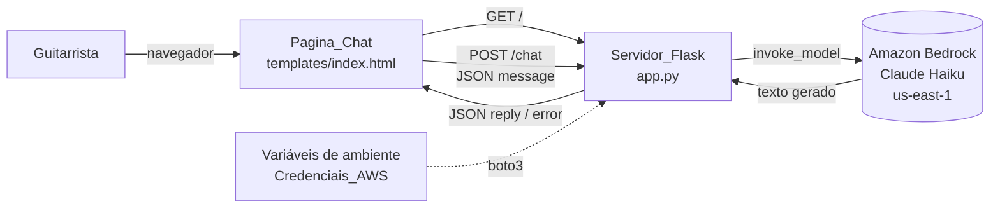
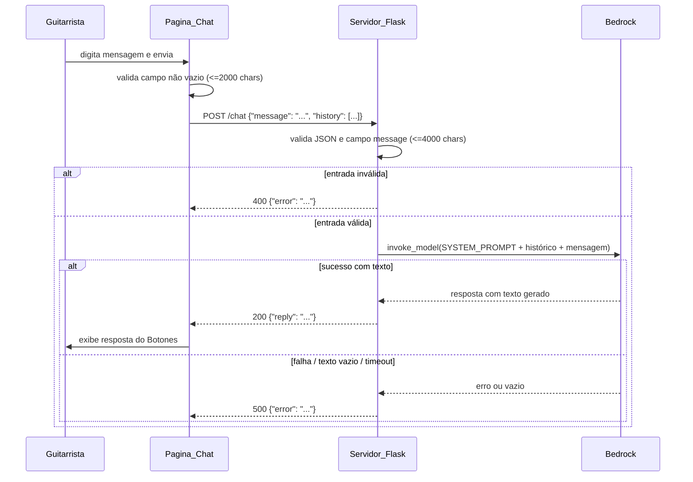

# Documento de Design

## Visão Geral

O "Botones" é um chatbot web mínimo e didático que ajuda guitarristas a montar presets no Amplitube 5, com a personalidade de um guitarrista doidão de death metal. O sistema é composto por um único servidor Python/Flask (`app.py`) que serve uma página de chat (`templates/index.html`) e expõe um endpoint de conversa (`/chat`) que delega a geração de respostas ao Amazon Bedrock (modelo Claude Haiku) via `boto3`.

O design prioriza simplicidade: poucos arquivos, código comentado em português, sem banco de dados, sem autenticação, sem frameworks adicionais. O histórico de conversa é mantido apenas no navegador (estado da página), de modo que o servidor permanece sem estado (stateless) entre requisições.

### Objetivos de design

- Atender integralmente a stack obrigatória do steering (`.kiro/steering/chatbot.md`).
- Manter o servidor stateless: cada requisição `/chat` é independente, e o contexto da conversa é enviado pelo cliente.
- Isolar personalidade e limites do bot numa única constante `SYSTEM_PROMPT`.
- Tratar erros de forma clara, retornando JSON com `error` e sem vazar credenciais AWS.
- Garantir respostas JSON com acentuação legível (`ensure_ascii = False`).

### Mapeamento de requisitos para componentes

| Requisito | Onde é atendido |
|-----------|-----------------|
| R1 Servir página de chat | Rota `/` (GET) + `templates/index.html` |
| R2 Receber e validar mensagens | Rota `/chat` (POST) + função de validação |
| R3 Gerar respostas via Bedrock | Cliente Bedrock (`boto3`) + função de invocação |
| R4 Personalidade do Botones | Constante `SYSTEM_PROMPT` |
| R5 Fluxo de coleta de informações | Instruções dentro do `SYSTEM_PROMPT` (conduzido pelo modelo) |
| R6 Segurança das credenciais AWS | Carregamento por variáveis de ambiente + validação na inicialização |
| R7 Execução e dependências | `app.py`, `requirements.txt`, `python app.py` em `localhost:5000` |

## Arquitetura

A aplicação segue uma arquitetura cliente-servidor simples, de três camadas lógicas dentro de um único processo:

1. **Camada de apresentação (navegador)**: `templates/index.html` com HTML, CSS e JavaScript embutidos. Mantém o histórico da conversa em memória do navegador e faz chamadas `fetch` à Rota_Chat.
2. **Camada de aplicação (Flask)**: `app.py`, que serve a página, valida entradas, monta o payload do modelo e trata erros.
3. **Camada de modelo (Amazon Bedrock)**: invocação do Claude Haiku via `bedrock-runtime` / `invoke_model`, na região `us-east-1`.

### Diagrama de componentes



### Fluxo de uma mensagem



### Decisões de arquitetura e justificativas

- **Servidor sem estado + histórico no cliente**: o steering proíbe banco de dados e pede projeto mínimo. Manter o histórico no navegador e reenviá-lo (opcionalmente) no corpo da requisição evita qualquer persistência no servidor. Como a conversa guiada do Requisito 5 depende de contexto, o cliente envia o histórico recente ao servidor, que o repassa ao modelo. Isso mantém o fluxo de perguntas coerente sem introduzir sessão/estado no servidor.
- **Lógica num único `app.py`**: atende à exigência de poucos arquivos e facilita a leitura didática. As responsabilidades são separadas em funções pequenas dentro do mesmo arquivo (validação, invocação do modelo, extração de texto, tratamento de erros).
- **Personalidade e fluxo conduzidos pelo modelo**: tanto a personalidade (R4) quanto o fluxo de coleta de informações (R5) são expressos como instruções no `SYSTEM_PROMPT`. Não há máquina de estados no servidor; o modelo conduz a conversa a partir das instruções e do histórico recebido. Isso mantém o código simples, como exige o steering.
- **Validação na borda**: a validação acontece tanto no cliente (UX imediata, R1.4) quanto no servidor (fonte de verdade, R2), já que o endpoint pode ser chamado diretamente.

## Componentes e Interfaces

### Servidor_Flask (`app.py`)

Responsável por inicializar a aplicação, carregar o cliente Bedrock e expor as rotas.

Elementos principais (todos no mesmo arquivo, comentados em português):

- `app = Flask(__name__)` e `app.json.ensure_ascii = False` — garante acentos legíveis nas respostas JSON (R2.5).
- `SYSTEM_PROMPT` — constante com personalidade, tom, idioma, escopo e fluxo de coleta (R4, R5).
- Constantes de configuração: `REGIAO = "us-east-1"`, `MODEL_ID = "us.anthropic.claude-haiku-4-5-20251001-v1:0"`, `TIMEOUT_SEGUNDOS = 30`, `LIMITE_CARACTERES = 4000`.
- Cliente Bedrock criado com `boto3.client("bedrock-runtime", region_name="us-east-1", config=Config(read_timeout=30, connect_timeout=30))`.

#### Rota `GET /` — servir a página de chat (R1)

- Entrada: requisição GET sem corpo.
- Processamento: renderiza `templates/index.html` com `render_template`.
- Saída: HTML com status 200 (R1.1). Em caso de falha de renderização (template ausente), retorna status 500 com indicação de que a página não pôde ser carregada (R1.2).

#### Rota `POST /chat` — processar mensagem (R2, R3)

- Entrada (corpo JSON):

```json
{
  "message": "quero um tom pesado estilo death metal",
  "history": [
    {"author": "guitarrista", "text": "..."},
    {"author": "botones", "text": "..."}
  ]
}
```

O campo `history` é opcional; quando presente, carrega o contexto da conversa para o modelo (suporta o fluxo guiado do R5). Quando ausente, o servidor trata a mensagem como início de conversa.

- Validação (ordem):
  1. Corpo ausente ou não-JSON válido → 400 com `error` indicando que o corpo deve ser JSON válido (R2.4).
  2. Campo `message` ausente, não-texto, vazio ou só espaços → 400 com `error` indicando que `message` é obrigatório e deve conter texto não vazio (R2.2).
  3. `message` com mais de 4000 caracteres → 400 com `error` de limite excedido (R2.3).
- Saída de sucesso: `200 {"reply": "<texto gerado>"}` (R2.1, R3.4).
- Saída de erro de modelo: `500 {"error": "<mensagem>"}` sem campo `reply` (R3.5, R3.6).

#### Funções auxiliares internas

- `validar_mensagem(dados) -> (ok, erro, texto)`: concentra as regras de validação de R2 e retorna o texto saneado ou a mensagem de erro apropriada.
- `montar_payload(mensagem, history)`: monta o corpo da invocação no formato esperado pelo Claude na Bedrock (ver Modelos de Dados), incluindo `SYSTEM_PROMPT` (R3.3) e o histórico como sequência de turnos.
- `invocar_modelo(payload) -> texto`: chama `bedrock-runtime.invoke_model` com `MODEL_ID` (R3.1, R3.2), respeita o timeout de 30s (R3.1/R3.6) e extrai o texto gerado da resposta.
- `extrair_texto(resposta_bruta) -> str`: lê o corpo da resposta da Bedrock e retorna o texto; retorna vazio quando não há texto, para acionar o tratamento de R3.5.

### Pagina_Chat (`templates/index.html`)

Página única com HTML, CSS e JavaScript embutidos (projeto mínimo, sem assets externos).

- **Campo de entrada**: `<textarea>` ou `<input>` aceitando de 1 a 2000 caracteres, com `maxlength="2000"` (R1.3).
- **Controle de envio**: botão "Mandar brasa" (ou similar) e envio também por tecla Enter.
- **Validação no cliente**: bloqueia envio quando o campo está vazio ou só com espaços e exibe aviso de campo obrigatório (R1.4).
- **Área de histórico**: lista de mensagens em ordem cronológica (mais antiga no topo), cada uma com rótulo visível do autor ("Você" para o Guitarrista e "Botones" para o bot) (R1.5). Inicia vazia quando não há mensagens na sessão (R1.6).
- **Comunicação**: usa `fetch("/chat", {method: "POST", ...})` enviando `message` e `history`. Ao receber `reply`, acrescenta a resposta ao histórico; ao receber `error` (400/500), exibe uma mensagem de erro amigável na conversa sem quebrar a página.
- **Estado**: array em memória do navegador com os turnos da conversa; descartado ao recarregar a página (sem persistência, conforme steering).

### Cliente_Bedrock

- Serviço: `bedrock-runtime`, região `us-east-1` (R3.1).
- Método: `invoke_model` com `modelId = MODEL_ID` exatamente `us.anthropic.claude-haiku-4-5-20251001-v1:0` (R3.2).
- Credenciais: resolvidas pelo `boto3` a partir de variáveis de ambiente (R6) — nenhuma chave no código.
- Timeout: 30 segundos por invocação, configurado via `botocore.config.Config` (R3.1, R3.6).

## Modelos de Dados

Não há persistência. Os modelos descritos abaixo são estruturas em trânsito (JSON de requisição/resposta e payload do modelo).

### Requisição para `/chat`

```json
{
  "message": "string, 1..4000 caracteres, obrigatório",
  "history": [
    {"author": "guitarrista | botones", "text": "string"}
  ]
}
```

### Resposta de sucesso de `/chat`

```json
{ "reply": "string não vazio" }
```

### Resposta de erro de `/chat`

```json
{ "error": "string descritiva" }
```

- 400 para entradas inválidas (R2.2, R2.3, R2.4).
- 500 para falha de geração/comunicação com o modelo (R3.5, R3.6).

### Payload de invocação da Bedrock (Claude Haiku)

O corpo enviado a `invoke_model` segue o formato de mensagens do Anthropic na Bedrock:

```json
{
  "anthropic_version": "bedrock-2023-05-31",
  "max_tokens": 1024,
  "system": "<conteúdo de SYSTEM_PROMPT>",
  "messages": [
    {"role": "user", "content": "..."},
    {"role": "assistant", "content": "..."},
    {"role": "user", "content": "<mensagem atual do Guitarrista>"}
  ]
}
```

- `system` recebe a constante `SYSTEM_PROMPT` (R3.3).
- `messages` reconstrói os turnos a partir de `history` (autor `guitarrista` → `user`, `botones` → `assistant`) seguidos da mensagem atual como `user`.

### Resposta bruta da Bedrock

O corpo retornado é lido (`response["body"].read()`), decodificado como JSON e o texto é extraído do primeiro bloco de conteúdo (`content[0].text`). Se não houver texto ou ele estiver vazio, aciona-se o fluxo de erro R3.5.

### Constante SYSTEM_PROMPT (conteúdo lógico)

A `SYSTEM_PROMPT` codifica, em texto, as regras dos requisitos R4 e R5:

- Personalidade: guitarrista de death metal, informal, com gírias de músico e entusiasmo por distorção, sempre respeitoso e sem conteúdo ofensivo (R4.1).
- Idioma: sempre responder em português do Brasil, mesmo que a mensagem venha em outro idioma (R4.2, R4.3).
- Escopo: responder apenas sobre presets do Amplitube 5, tom de guitarra, equipamentos e técnica de guitarra; fora disso, recusar educadamente, explicar o escopo e pedir reformulação (R4.4, R4.5).
- Fluxo de coleta: perguntar, uma de cada vez, (1) o que quer tocar, (2) referências de som, (3) tipo de guitarra, (4) banda a replicar; ao reunir as quatro, sugerir um preset; se o usuário pedir o preset antes, sugerir com o que houver e sinalizar o que falta (R5.1 a R5.7).

## Tratamento de Erros

| Situação | Origem | Resposta | Requisito |
|----------|--------|----------|-----------|
| Template ausente/erro ao renderizar `/` | Flask | 500 com indicação de página indisponível | R1.2 |
| Envio com campo vazio no cliente | Pagina_Chat | Bloqueio do envio + aviso de obrigatório | R1.4 |
| Corpo não-JSON em `/chat` | Flask | 400 `{"error": "corpo deve ser JSON válido"}` | R2.4 |
| `message` ausente/não-texto/vazio | Flask | 400 `{"error": "message é obrigatório e não vazio"}` | R2.2 |
| `message` acima de 4000 chars | Flask | 400 `{"error": "mensagem excede o limite"}` | R2.3 |
| Bedrock retorna texto vazio | Flask | 500 `{"error": "falha na geração"}` sem `reply` | R3.5 |
| Bedrock falha ou excede 30s | Flask | 500 `{"error": "falha na comunicação com o modelo"}` sem `reply` | R3.6 |
| Credenciais AWS ausentes na inicialização | Flask (startup) | Interrompe a inicialização e registra erro indicando quais credenciais faltam, sem expor valores | R6.3, R6.4 |
| Porta 5000 em uso | Flask (startup) | Encerra inicialização e registra erro de porta indisponível | R7.2 |

Diretrizes:

- Erros do modelo são capturados com `try/except` em torno de `invoke_model`, cobrindo erros do serviço e timeout (R3.6).
- Mensagens de erro e logs nunca incluem valores de credenciais; qualquer referência usa um indicador de valor ocultado (R6.4).
- A inicialização verifica a presença das variáveis de ambiente das credenciais antes de aceitar requisições (R6.1, R6.3).

### Segurança das credenciais (R6)

- As credenciais são lidas exclusivamente de variáveis de ambiente, resolvidas pelo `boto3`/`botocore` (R6.1).
- Nenhuma chave é escrita no código-fonte (R6.2).
- Na inicialização, verifica-se a existência das variáveis esperadas (por exemplo `AWS_ACCESS_KEY_ID`, `AWS_SECRET_ACCESS_KEY`, `AWS_REGION`/`us-east-1`); se faltarem, o servidor não sobe e registra quais faltam, sem exibir valores (R6.3, R6.4).

## Estratégia de Validação

> Observação importante: o steering do projeto (`.kiro/steering/chatbot.md`) proíbe explicitamente testes automatizados. Portanto, este design **não** inclui testes unitários, de integração ou property-based testing como tarefas de implementação. A validação é feita manualmente pelo desenvolvedor, conforme o roteiro abaixo.

### Roteiro de verificação manual

Execução: `python app.py` e acesso a `http://localhost:5000` (R7.1).

1. **Página de chat (R1)**
   - Abrir `/` e confirmar que a página carrega (status 200) com campo de entrada e botão de envio.
   - Confirmar que a área de histórico inicia vazia (R1.6).
   - Tentar enviar com o campo vazio/só espaços e verificar o bloqueio com aviso (R1.4).
   - Enviar algumas mensagens e confirmar ordem cronológica e identificação de autor (R1.5).

2. **Validação do endpoint (R2)** — usar o navegador ou `curl`:
   - POST `/chat` com `{"message": "oi"}` → 200 com `reply`.
   - POST `/chat` com corpo não-JSON → 400 com `error` (R2.4).
   - POST `/chat` sem `message` ou com `message` vazio/espaços → 400 (R2.2).
   - POST `/chat` com `message` acima de 4000 caracteres → 400 (R2.3).
   - Conferir que respostas com acento aparecem legíveis (R2.5).

3. **Geração via Bedrock (R3)**
   - Com credenciais válidas, confirmar que mensagens válidas retornam `reply` gerado pelo modelo.
   - Simular indisponibilidade (por exemplo, credenciais inválidas ou região incorreta) e confirmar 500 com `error`, sem `reply` (R3.5, R3.6).

4. **Personalidade e escopo (R4)**
   - Enviar pergunta sobre guitarra e observar tom informal/death metal em português.
   - Enviar mensagem em inglês e confirmar resposta em português (R4.3).
   - Enviar pergunta fora do escopo (ex.: receita de bolo) e confirmar recusa educada com pedido de reformulação (R4.5).

5. **Fluxo de coleta (R5)**
   - Iniciar conversa e confirmar que o bot pergunta o que quer tocar, depois referências, tipo de guitarra e banda, uma por vez (R5.1 a R5.5).
   - Fornecer as quatro informações e confirmar a sugestão de preset (R5.6).
   - Pedir o preset antes de responder tudo e confirmar que o bot sugere com o disponível e sinaliza o que falta (R5.7).

6. **Credenciais e execução (R6, R7)**
   - Iniciar sem variáveis de ambiente de credenciais e confirmar que o servidor não sobe e registra quais faltam, sem expor valores (R6.3, R6.4).
   - Confirmar que o `requirements.txt` declara `flask` e `boto3` e que `pip install -r requirements.txt` + `python app.py` sobe em `localhost:5000` (R7.1, R7.3, R7.4).
   - Com a porta 5000 ocupada, confirmar o erro de porta indisponível (R7.2).
